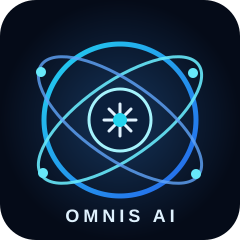

<div align="center">



# 🌌 OMNIS Intelligence OS (v2.0)

**The Ultimate Decoupled AI Operating System Architecture**

[](https://github.com/Davood121/OMNIS-Intelligence-OS_2/actions/workflows/static.yml)
[](https://python.org)
[](#)
[](#)
[](https://opensource.org/licenses/MIT)

*An advanced, hyper-modular framework designed to bridge massive local backend intelligence with a sleek, real-time graphical interactive frontend.*

[**Live Interactive Demo (GitHub Pages)**](https://Davood121.github.io/OMNIS-Intelligence-OS_2)

</div>

---

## 🚀 Overview: Beyond a Dashboard

**OMNIS Intelligence OS** aims to radically redefine how humans interact with local and cloud-based artificial intelligence. Instead of static scripts or basic chat windows, OMNIS is engineered as a **simulated Operating System**.

By entirely decoupling the interface (Frontend) from the neural logic (Backend), OMNIS achieves unparalleled scalability, enabling users to hook up massive local LLMs (like Ollama or LLaMA), computer vision models, and custom python agents into a single, cohesive, futuristic glassmorphism environment.

---

## ✨ Comprehensive Features

### 🖥️ Next-Gen Interface (The UI)
- **Neural Glassmorphism:** A stunning visually-immersive CSS aesthetic featuring deep blurs, edge-lighting, and dynamic matrix backgrounds.
- **Real-Time System Monitoring:** Live, responsive widgets visually calculating and simulating memory usage and CPU core loads.
- **Node Link Architecture:** Visual representation of active "Neural Links" such as computer vision cores and deep thought routines.
- **Fully Responsive:** Adapts from massive ultrawide monitors down to mobile terminal setups without breaking.

### 🧠 The Intelligence Core (Backend Logic)
- **Decoupled Mechanics:** The Python backend operates entirely asynchronously, processing heavy machine-learning scripts independently of the UI thread.
- **Agentic Routing:** Easily plug in logic routers to direct queries either to web-search instances or local LLMs based on intent.
- **WebSocket Ready:** The architecture easily supports upgrades to WebSocket (WSS) streaming for absolute zero-latency token generations.

---

## 🛠️ System Architecture

OMNIS handles processes via a strict directory abstraction strategy.

```text
OMNIS-Intelligence-OS_2/
├── frontend/               # The browser-based visual OS
│   ├── index.html          # Core layout and OS container
│   ├── index.css           # Glassmorphism design system
│   └── script.js           # Live widgets and interaction scripts
├── backend/                # Heavy lifting intelligence cores
│   ├── memory_manager.py   # Vectorized contextual history
│   ├── inference_node.py   # Connection to local/remote LLMs
│   └── start.py            # Primary Python launch sequence
├── .github/workflows/      # Automated cloud deployment pipelines
├── requirements.txt        # Backend dependencies
└── START_SERVERS.bat       # Lightning-fast dual server init script
```

---

## 💻 Installation & Setup

### For End-Users (Just viewing the OS)
If you only want to use the interface, no installation is required! Simply click the **Live Demo** link at the top of the repository or open `index.html` directly in your favorite modern browser (Chrome, Edge, Firefox).

### For Developers (Running the Backend Cores)
1. **Clone the Repository**
   ```bash
   git clone https://github.com/Davood121/OMNIS-Intelligence-OS_2.git
   cd OMNIS-Intelligence-OS_2
   ```

2. **Establish the Environment**
   Ensure Python 3.9+ is installed.
   ```bash
   python -m venv omnis_env
   source omnis_env/bin/activate  # On Windows: omnis_env\Scripts\activate
   pip install -r requirements.txt
   ```

3. **Ignite the OS**
   Execute the boot sequence to bring both the intelligence cores and the visual interface online simultaneously:
   ```bash
   ./START_SERVERS.bat
   ```

---

## 🗺️ Product Roadmap

- [x] Establish Core Frontend Aesthetic / Glassmorphism Framework
- [x] Automate CI/CD Deployment via GitHub Actions
- [ ] Incorporate local Ollama integrations for offline intelligence
- [ ] Add Voice-to-Text (VTT) Whisper capabilities
- [ ] Implement robust persistent memory utilizing SQLite

---

## 🤝 Contribution Guidelines

OMNIS Intelligence OS is an Open Source initiative. We welcome all developers, UI/UX designers, and Machine Learning engineers to help expand the OS. 

To contribute:
1. Fork the repository
2. Create your Feature Branch (`git checkout -b feature/AmazingNode`)
3. Commit your Changes (`git commit -m 'Add some AmazingNode'`)
4. Push to the Branch (`git push origin feature/AmazingNode`)
5. Open a Pull Request

<div align="center">
  <br>
  <strong>Programmed and Architected by <a href="https://github.com/Davood121">Davood121</a></strong>
</div>
